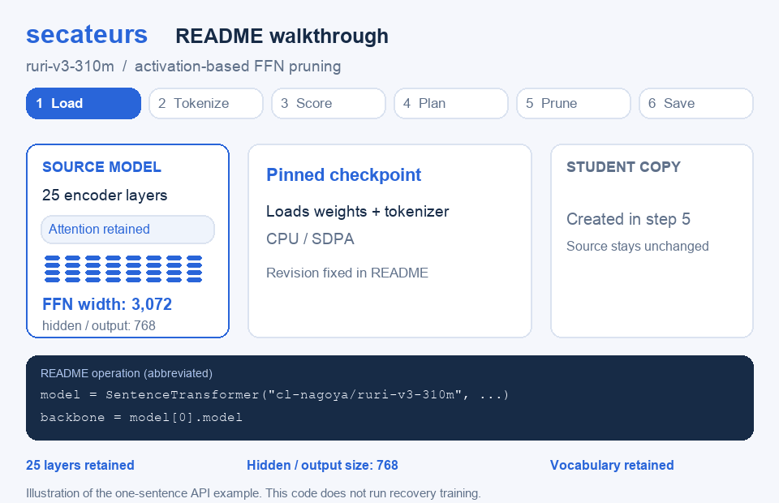

# secateurs

[English](README.md) | 日本語

Transformerエンコーダー向けの、**UltraBERT-inspired pruningの初期実験**です。

このプロジェクトは始まったばかりです。[UltraBERT](https://arxiv.org/abs/2610.15028v1)のpruningと回復学習の流れを、既存の埋め込みモデルに応用する過程を記録しています。まずModernBERTとruri-v3-310mを対象とします。意図的な変更を含む部分的な再現研究であり、論文の学習手順や報告された結果を再現したものではありません。

将来は、明確なrecipe、信頼できる保存・読み込み、再現可能な評価を備えた、便利で再利用しやすいpruningライブラリを目指します。現状は、ModernBERTのFFN幅pruning、任意依存のSentence Transformersアダプター、埋め込み回復学習サンプルに絞ったプロトタイプです。APIは変更される可能性があります。品質と性能の検証全体は未完了で、回復学習後に品質が下がったタスクもあります。

## UltraBERTとの関係

共通する考え方は、前向き計算の活性値で重要度を順位付けし、層数を保ったまま重み行列を物理的に小さくし、教師から生徒の挙動を回復する学習を行うことです。現在の実装には、次の重要な違いがあります。

- 削るのはFFN中間ニューロンだけで、hidden幅とattentionは維持します。
- スコアは有効トークン上のゲート適用後の活性値の絶対値平均であり、UltraBERTの系列平均・バッチ方向L2集約とは異なります。
- 回復学習は文埋め込みをMSEで模倣するもので、単語予測logitsをKLで模倣する方式ではありません。
- マスク率の混合、複数LM head、選択的な蒸留、段階的に小さいエンコーダーを作るcascadeは実装していません。

厳密な対象範囲と一次資料は[研究上の比較](docs/ja/research.md)、参照実験と途中結果は[実験記録](docs/ja/experiments.md)、残る作業は[ロードマップ](docs/ja/roadmap.md)を参照してください。パラメータ削減は実装済みですが、一般的な品質維持や推論の高速化は実証していません。

## ソースからのインストール

Python 3.10〜3.12に対応しています。ソースをcheckoutしたディレクトリで実行します。

```bash
uv sync --locked --extra sentence-transformers
uv run pytest
```

埋め込み回復学習サンプルを使う場合は`--extra training`も追加してください。コアパッケージはPyTorchとTransformersを使用し、Sentence Transformersは任意依存です。モデルやデータセットのダウンロードは利用者が明示的に実行する操作であり、それぞれのライセンスに従います。

## Sentence Transformerのpruning

```python
from sentence_transformers import SentenceTransformer
from secateurs import activation_scores, make_plan
from secateurs.sentence_transformers import prune_sentence_transformer

model = SentenceTransformer(
    "cl-nagoya/ruri-v3-310m",
    revision="18b60fb8c2b9df296fb4212bb7d23ef94e579cd3",
    device="cpu",
    model_kwargs={"attn_implementation": "sdpa"},
)
backbone = model[0].model

features = model.preprocess(["検索文書: 日本の首都は東京です。"])
batch = {key: features[key] for key in ("input_ids", "attention_mask")}

scores = activation_scores(backbone, [batch])
plan = make_plan(backbone, target_width=2304, scores=scores)
student = prune_sentence_transformer(model, plan)

student.save("artifacts/student")
plan.save("artifacts/student/pruning_plan.json")
```



アニメーションは上のコードの処理を図解しています。25層それぞれのFFN幅を3,072から2,304へ減らし、元モデル・hidden幅・出力次元・語彙は維持します。ニューロンのグループとスコアは模式図です。この例はpruning済みモデルと選択計画を保存するもので、回復学習は実行しません。

1文だけの入力はAPIの使い方を示す例です。実際の選択には、用途を代表する学習・校正用テキストを使い、再現性のためモデルのrevisionを固定してください。元モデルは保持しますが、コピーの作成には追加のメモリーが必要です。`make_plan(..., scores=None, seed=0)`はseed付きランダム選択の対照条件になります。計画は`FFNPlan.save`と`FFNPlan.load`で保存・読み込みできます。

## 対応範囲

- 全層で共通の目標FFN中間幅を使うModernBertModel。
- 明示的な層ごとのニューロンインデックス、またはpaddingを除外したゲート適用後の活性値スコア。
- 標準のモデル設定と保存・読み込み。専用の推論カーネルは使いません。
- パッケージAPIの型ヒントを`py.typed`マーカーとともに配布します。
- 残差の幅、語彙、attention、RoPE、poolingは変更しません。
- 通常の浮動小数点重みを対象とし、コンパイル・量子化・分散ラッパーの適用やoptimizerの作成前に実行します。

出力次元を保っても、埋め込み空間の互換性は保たれません。検索評価の前に生徒モデルで文書を再エンコードしてください。FFN幅の削減率とモデル全体のパラメータ削減率は同じではありません。回復学習は現時点ではサンプルスクリプトであり、汎用の蒸留APIではありません。ほかのアーキテクチャやpruning recipeは今後の作業です。

## サンプルと検証

各サンプルは主目的を1つに絞り、個別のコマンドライン実行に対応します。

| サンプル | 目的 | 主な入出力 |
| --- | --- | --- |
| `examples/prepare_data.py` | 参照実験の学習テキストを準備 | 固定したJSTS train splitからテキストと由来の記録を作成 |
| `examples/ruri_pilot.py` | ruriを校正しpruning | 校正テキストと目標幅から、生徒モデル・計画・参照実験レポートを作成 |
| `examples/distill.py` | MSEで文埋め込みを回復 | 教師・生徒・学習テキストから、回復済み生徒と学習レポートを作成 |
| `examples/verify_saved.py` | 保存したエンコーダーを検証 | モデルのパスから、次元・正規化・読み込みを確認 |
| `examples/benchmark.py` | CPUエンコードの性能を測定 | モデルと系列長上限から、時間・メモリーの測定結果を作成 |

pruningサンプル内の再読み込み確認は、自身の出力の動作確認です。任意の時間測定も診断用に留め、固定したCPU処理の測定には別のベンチマークコマンドを使い、モデルごとに新しいプロセスで実行してください。引数は`--help`で確認できます。すべてのサンプルにSentence Transformers extraが必要で、データ準備と回復学習にはtraining extraも必要です。CPUベンチマークはUnixの`resource`モジュールを使うためLinux/macOSで実行します。実モデルのサンプルにはダウンロードまたは利用者が用意したデータが必要ですが、既定のテストはオフラインのfixtureを使います。

テストには小さなオフラインモデルを使い、元サイズの参照モデルとの数値一致、元モデルの保持、勾配、不正な計画、シリアライズを確認します。

[pruning仕様](docs/ja/pruning.md)、[互換性](docs/ja/compatibility.md)、[回復学習](docs/ja/recovery.md)、[評価方針](docs/ja/evaluation.md)、[開発への参加（英語）](CONTRIBUTING.md)、[変更履歴（英語）](CHANGELOG.md)、[MITライセンス](LICENSE)も参照してください。

## 謝辞と引用

本プロジェクトのpruning・回復学習の実験は、Jungwoo Park、Taewhoo Lee、Jaewoo Kangによる[UltraBERT: Beyond the Limit of BERT Pre-Training](https://arxiv.org/abs/2610.15028v1)に着想を得ています。著者の皆様に感謝します。取り入れた要素と元の方法との差分は[研究上の比較](docs/ja/research.md)に記載しています。

UltraBERTの方法に基づく研究では、元論文を引用してください。

```bibtex
@misc{park2026ultrabert,
  title         = {{UltraBERT}: Beyond the Limit of {BERT} Pre-Training},
  author        = {Jungwoo Park and Taewhoo Lee and Jaewoo Kang},
  year          = {2026},
  eprint        = {2610.15028},
  archivePrefix = {arXiv},
  primaryClass  = {cs.CL},
  url           = {https://arxiv.org/abs/2610.15028v1}
}
```
